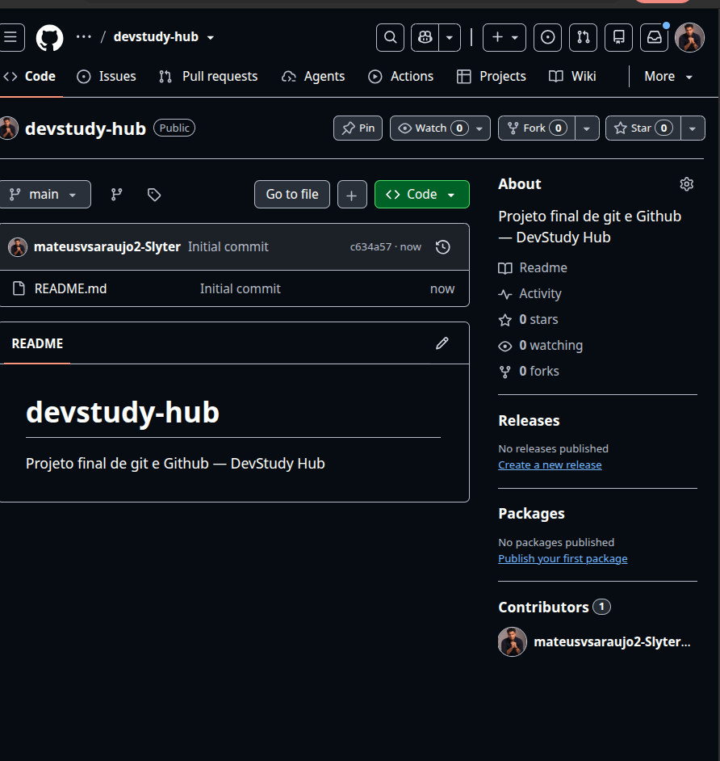
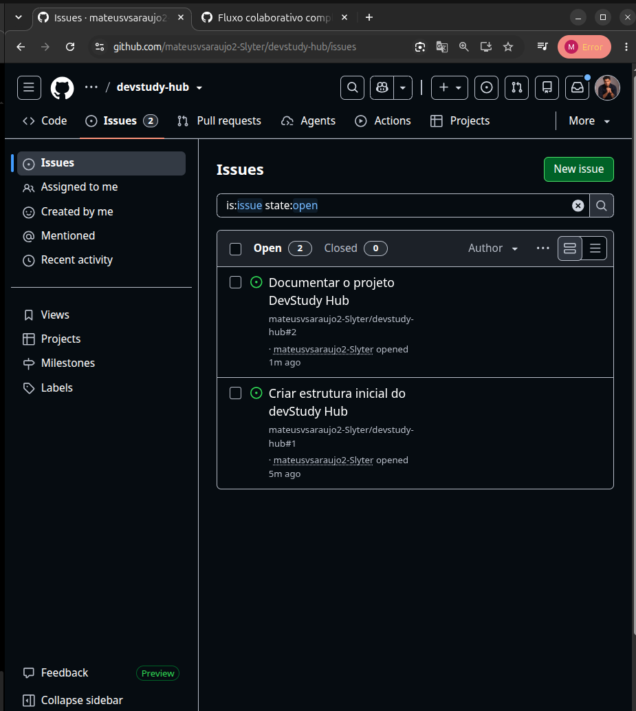
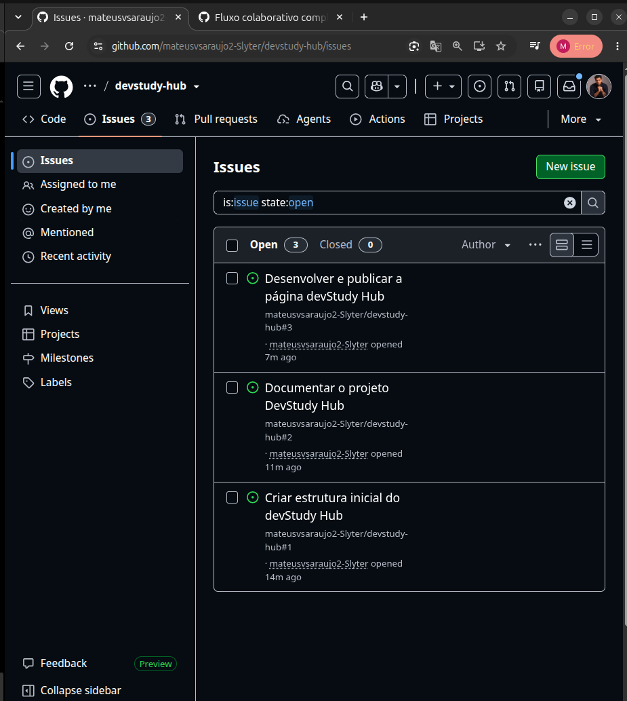
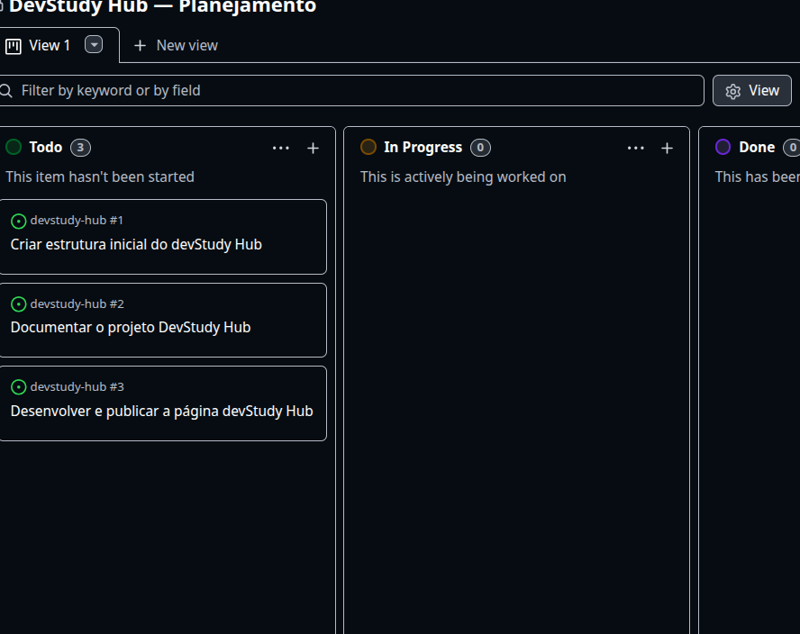

# Etapa 1 — Planejamento do DevStudy Hub

## 1. Objetivo

Criamos o repositório DevStudy Hub com o objetivo de organizar um fluxo de trabalho para desenvolver um projeto em equipe chamado DevStudy Hub.

## 2. Procedimentos realizados

Para isso, criamos três Issues:

- **Issue #1:** Criar a estrutura inicial do projeto.
- **Issue #2:** Documentar o projeto.
- **Issue #3:** Desenvolver e publicar a página.

Vinculamos as Issues ao GitHub Projects para acompanhar o fluxo de desenvolvimento.

## 3. Resultado

Organizamos nossas tarefas no GitHub Projects, identificando quais estão pendentes, em andamento ou concluídas.

Essa organização nos permite acompanhar o progresso do projeto e relacionar as atividades às respectivas Issues.

## 4. Evidências

### Criação do repositório no GitHub

### Criação das Issues

### Organização das Issues

### Quadro do GitHub Project

