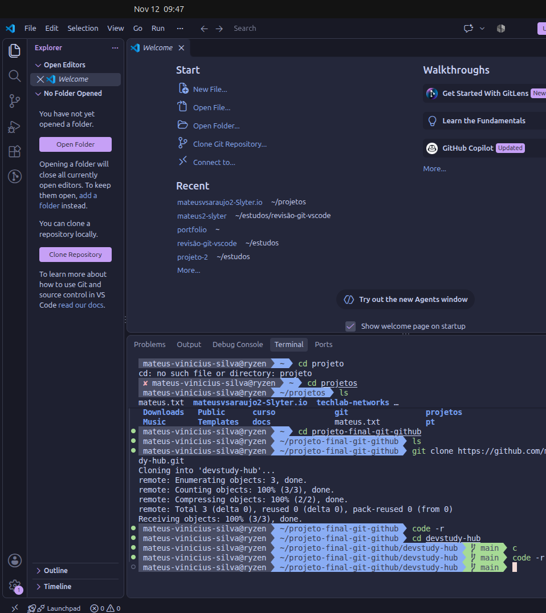
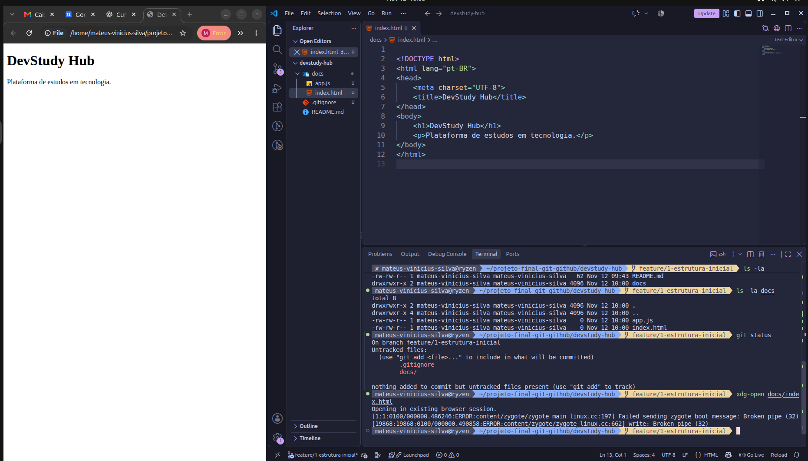
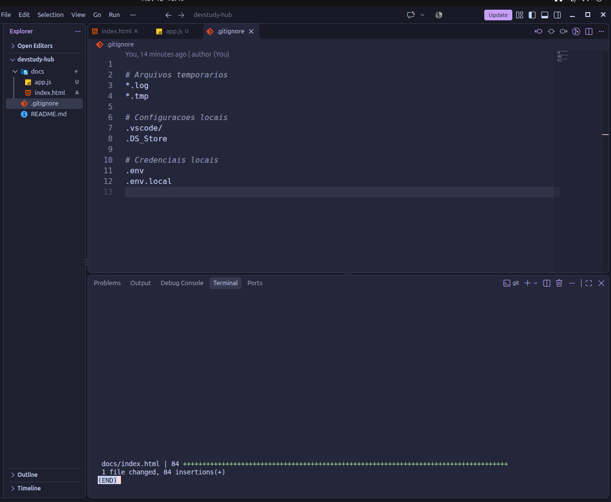
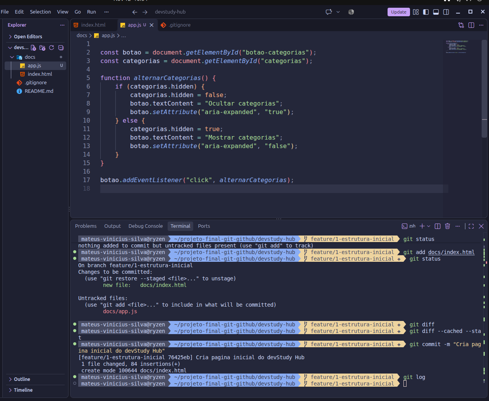
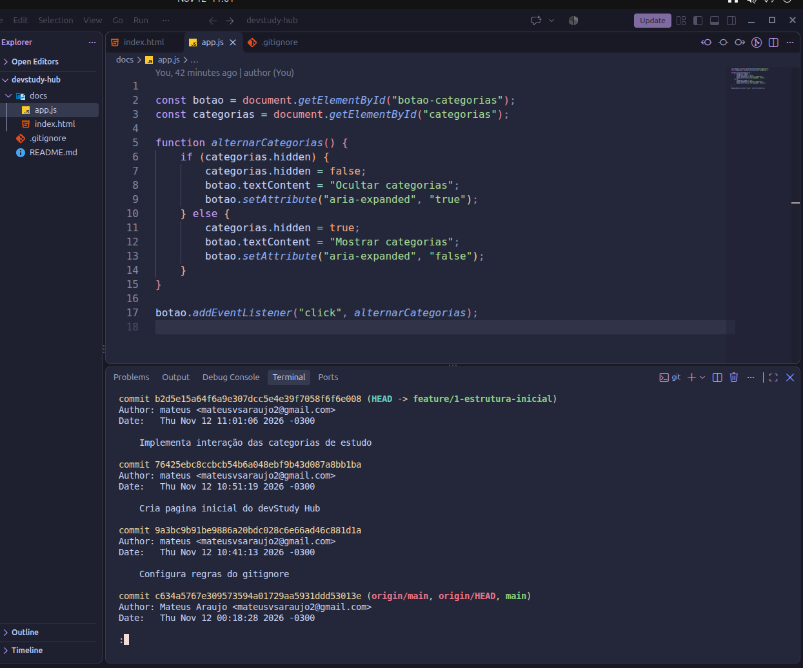
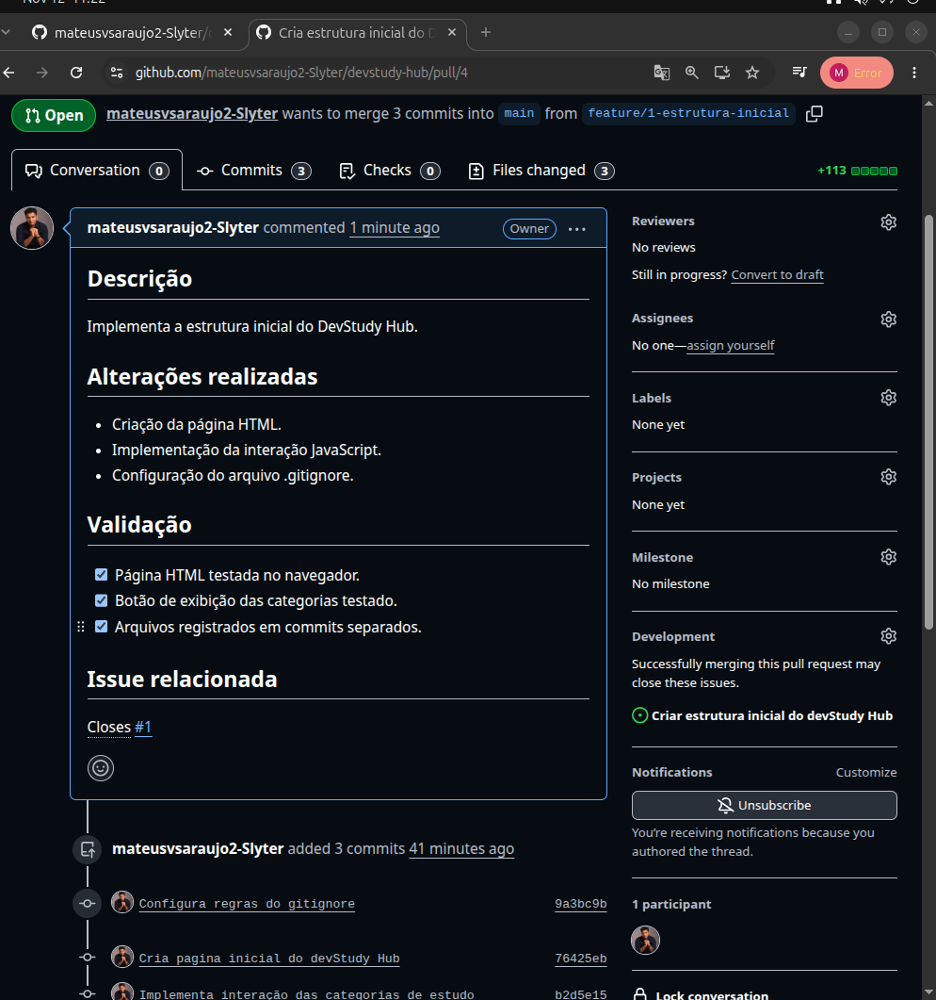
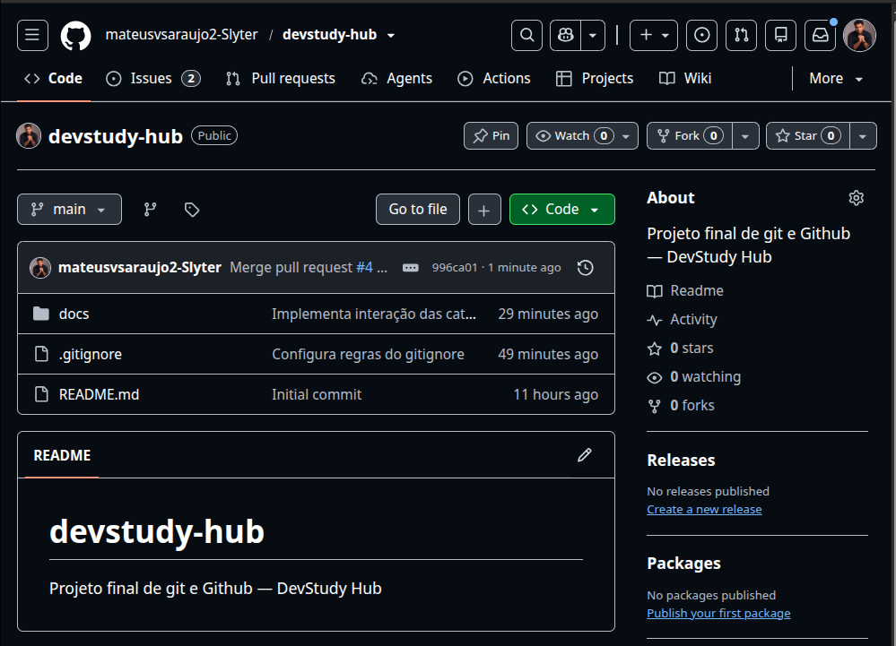
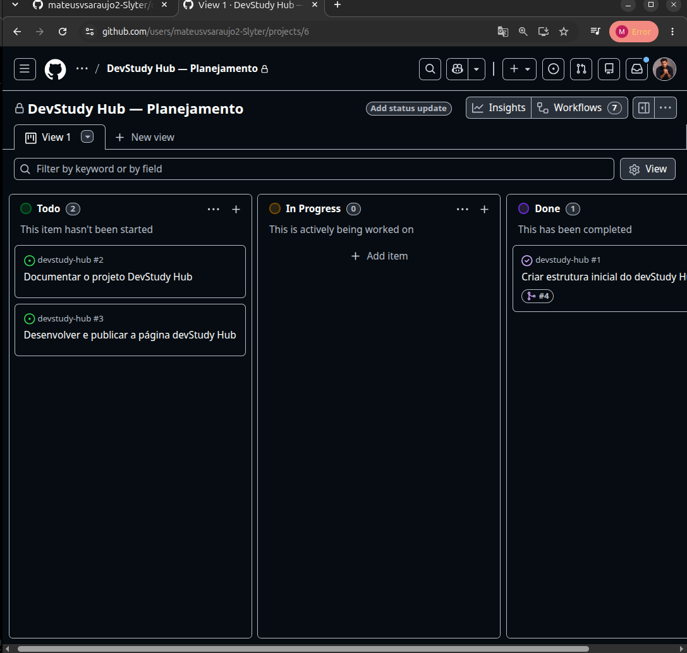

# Etapa 2 — Estrutura inicial do DevStudy Hub

## 1. Objetivo

Criamos a branch `feature/1-estrutura-inicial` para desenvolver e organizar a estrutura de diretórios e arquivos do DevStudy Hub sem modificar diretamente a branch principal (`main`).

Nosso objetivo foi preparar a estrutura inicial do projeto, criando os arquivos HTML, JavaScript e `.gitignore`, para posteriormente revisar as alterações e integrá-las à `main`.

## 2. Procedimentos realizados

Durante nosso desenvolvimento, utilizamos comandos como `git add` para adicionar os arquivos alterados à Staging Area, preparando-os para serem registrados.

Utilizamos `git commit` para salvar essas alterações no histórico do repositório Git, armazenado no diretório `.git`, e `git push` para enviar os commits ao repositório remoto no GitHub.

## 3. Validação

Abrimos a Pull Request #4 para revisar nossos códigos e corrigir possíveis erros antes de integrá-los à branch `main`.

Para validar as alterações, verificamos o diff dos arquivos `.gitignore`, `docs/index.html` e `docs/app.js`, garantindo que somente os arquivos necessários fossem incluídos.

Após a revisão, realizamos o merge e concluímos a Issue #1.

## 4. Resultado

No final, conseguimos realizar o merge da branch `feature/1-estrutura-inicial` na nossa branch principal, `main`.

Todos os arquivos estavam corretos, a estrutura inicial foi integrada ao projeto e nossa Issue #1 foi fechada.

## 5. Evidências

### Clonagem do repositório

### Desenvolvimento da página HTML

### Estrutura inicial de arquivos

### Histórico do trabalho

### Registro dos commits

### Abertura da Pull Request #4

### Merge na branch main

### Conclusão da Issue #1

