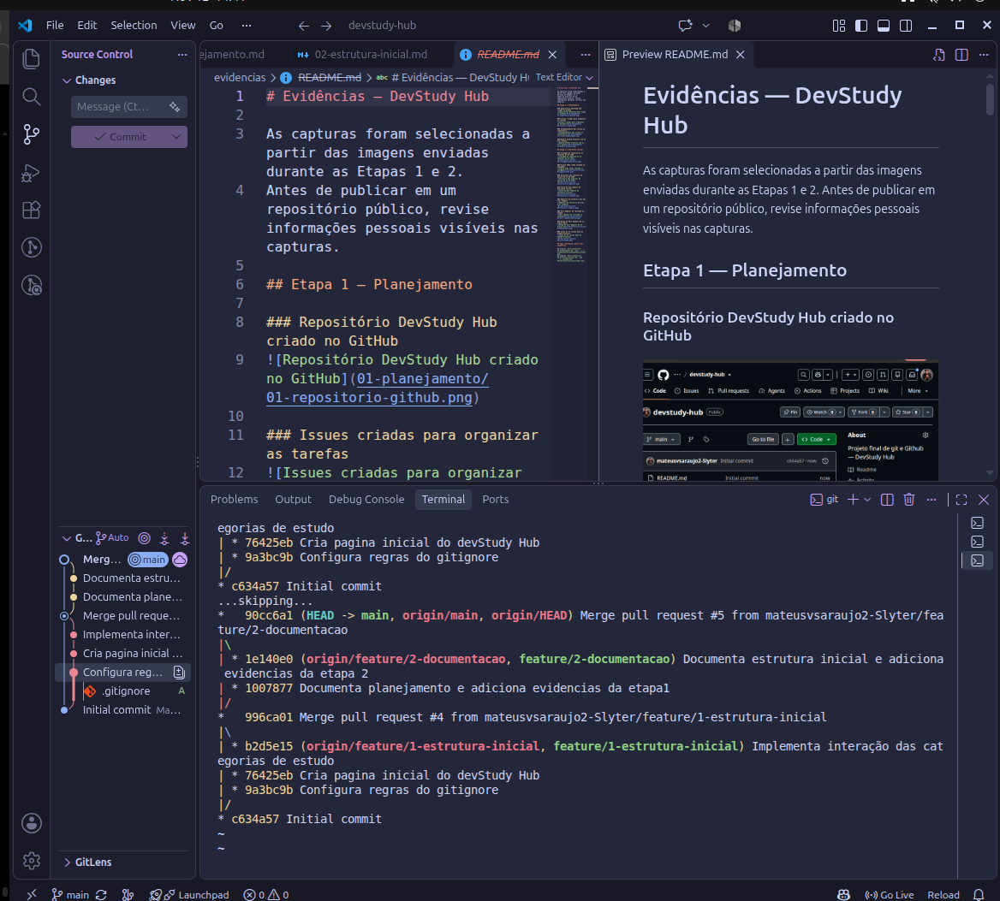
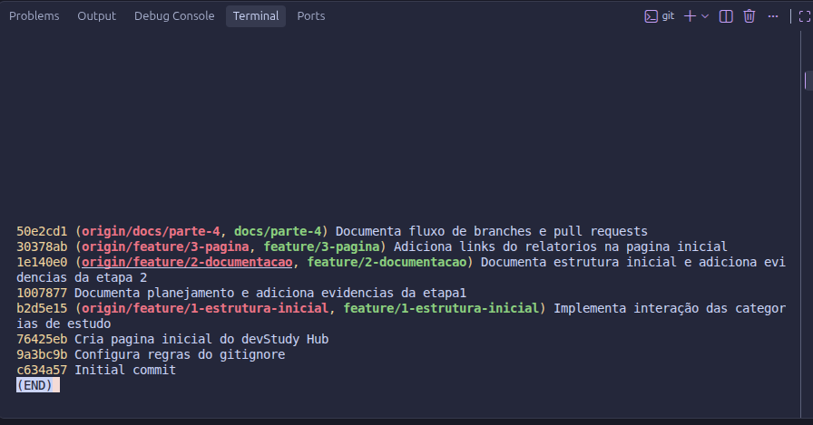

# Parte 3 — Histórico Git

## 1. Objetivo

Verificar o histórico do repositório DevStudy Hub e acompanhar os commits significativos exigidos pela Issue [#266](https://github.com/tech-devops-ltda/DevOps/issues/266).

## 2. Procedimentos realizados

Utilizamos os comandos:

```bash
git log --oneline --graph --decorate
git log --oneline --no-merges
```

O primeiro exibe os commits de forma resumida, com as ramificações e referências do Git. O segundo oculta os commits de merge, facilitando a identificação dos registros de desenvolvimento e documentação.

## 3. Importância do histórico Git

Foi importante utilizar o comando `git log` para visualizar e analisar cada um dos commits realizados durante o desenvolvimento do DevStudy Hub, acompanhando a linha do tempo das alterações no repositório.

Também identificamos mensagens, autores e identificadores dos commits para compreender a evolução do projeto.

## 4. Análise dos commits

Na consulta registrada antes da criação deste relatório, encontramos sete commits de conteúdo e um commit inicial, desconsiderando os commits de merge:

| Commit | Descrição da alteração |
|---|---|
| `9a3bc9b` | Configuração do `.gitignore` |
| `76425eb` | Criação da página inicial |
| `b2d5e15` | Implementação da interação das categorias |
| `1007877` | Documentação do planejamento e evidências da Parte 1 |
| `1e140e0` | Documentação da estrutura e evidências da Parte 2 |
| `30378ab` | Inclusão dos links dos relatórios na página |
| `50e2cd1` | Documentação do fluxo de branches e Pull Requests |

O commit `c634a57` é o commit inicial e foi identificado separadamente. Os commits de merge preservam o histórico das integrações, mas não foram incluídos na contagem de sete alterações de conteúdo.

**Validação do requisito:** o commit que adiciona este Relatório 03 e suas evidências representa a oitava alteração documentada. Após a integração, a contagem deve ser confirmada novamente com `git log --oneline --no-merges` na `main`.

## 5. Evidências

### Visualização gráfica do histórico e dos merges



### Histórico resumido sem commits de merge



## 6. Resultado

Conseguimos consultar a evolução do repositório e diferenciar commits de desenvolvimento dos commits de merge. O histórico passou a servir como evidência das alterações realizadas e de sua organização ao longo do projeto.
