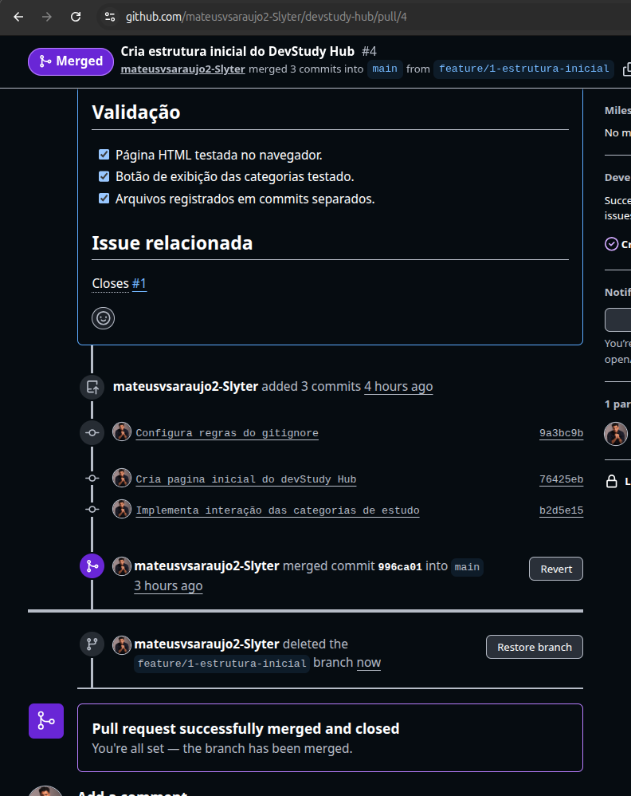
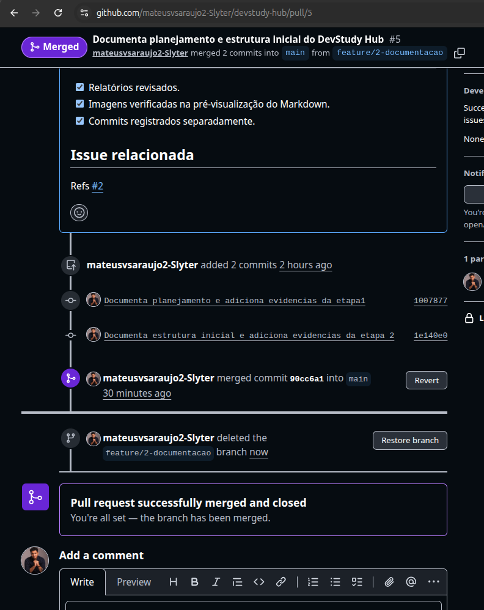
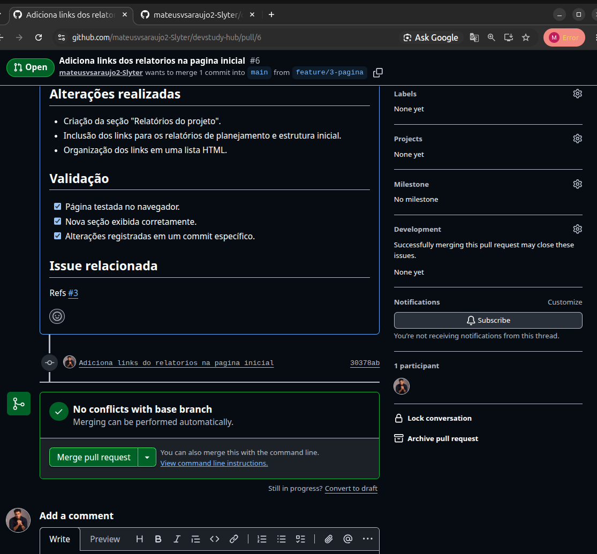
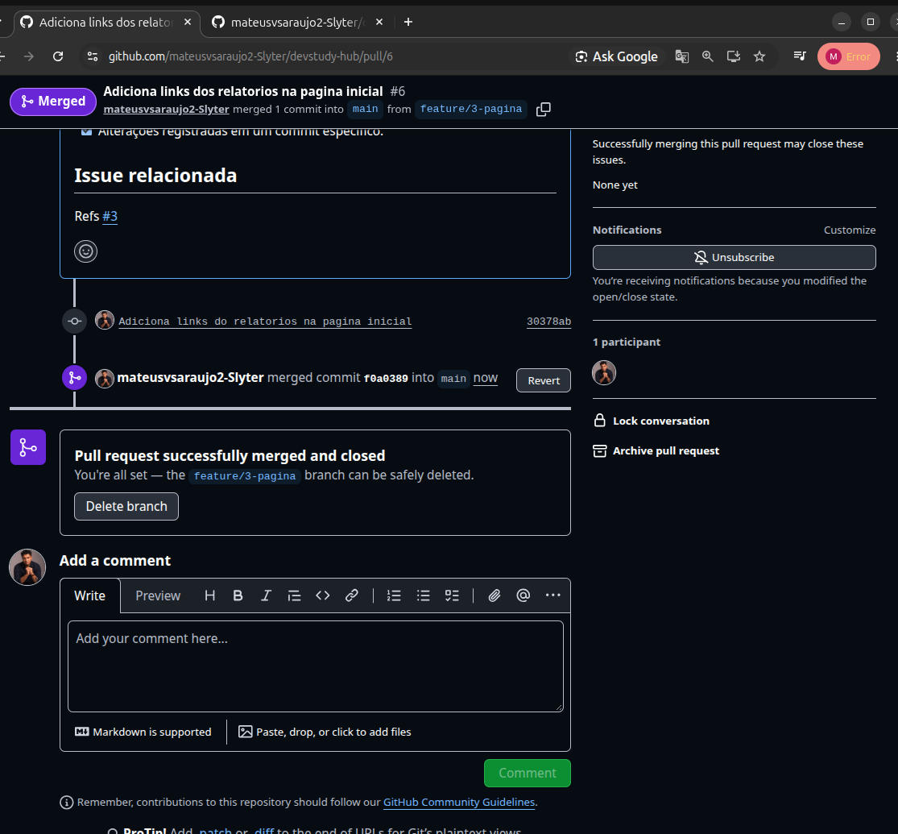
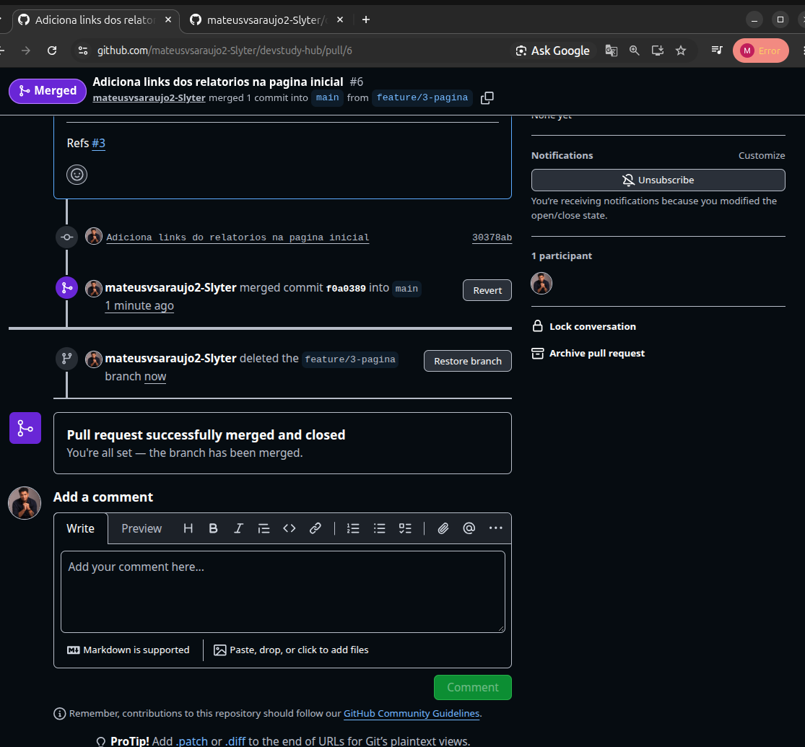

# Parte 4 — Branches e Pull Requests

## 1. Objetivo

Foi muito importante criar branches separadas para manter a organização do projeto e desenvolver mudanças sem alterar diretamente a branch principal, `main`. Utilizar Pull Requests nos ajudou a conferir e analisar os arquivos antes de integrar as alterações à `main`.

## 2. Procedimentos realizados

Criamos branches específicas para cada tipo de atividade:

- `feature/1-estrutura-inicial`: arquivos iniciais e código do projeto.
- `feature/2-documentacao`: relatórios e evidências das Partes 1 e 2.
- `feature/3-pagina`: seção com links para os relatórios na página inicial.

Em cada branch, registramos as alterações em commits e as enviamos ao GitHub. Depois, abrimos Pull Requests para revisar as diferenças antes de realizar o merge na `main`.

## 3. Validação

| Pull Request | Objetivo | Issue relacionada | Resultado |
| --- | --- | --- | --- |
| [#4](https://github.com/mateusvsaraujo2-Slyter/devstudy-hub/pull/4) | Estrutura inicial | [#1](https://github.com/mateusvsaraujo2-Slyter/devstudy-hub/issues/1) | Merge realizado; Issue #1 fechada |
| [#5](https://github.com/mateusvsaraujo2-Slyter/devstudy-hub/pull/5) | Relatórios e evidências | [#2](https://github.com/mateusvsaraujo2-Slyter/devstudy-hub/issues/2) | Merge realizado; Issue #2 permanece aberta |
| [#6](https://github.com/mateusvsaraujo2-Slyter/devstudy-hub/pull/6) | Links dos relatórios na página | [#3](https://github.com/mateusvsaraujo2-Slyter/devstudy-hub/issues/3) | Merge realizado; Issue #3 permanece aberta |

Confirmamos a ausência de conflitos, conferimos os arquivos alterados e excluímos as branches **remotas** depois das integrações. Os commits permanecem preservados na `main`.

## 4. Resultado

Cumprimos os requisitos da Parte 4: utilizamos uma branch para código, uma para documentação e uma para página; abrimos três Pull Requests relacionadas a Issues; revisamos as alterações antes do merge e limpamos as branches remotas integradas.

## 5. Evidências

### Pull Request #4 integrada e branch de código excluída

### Pull Request #5 integrada e branch de documentação excluída

### Pull Request #6 aberta, vinculada à Issue #3

### Pull Request #6 integrada à main

### Branch de página excluída após o merge

