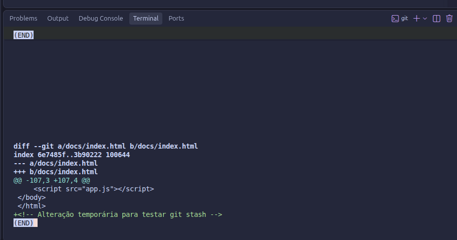
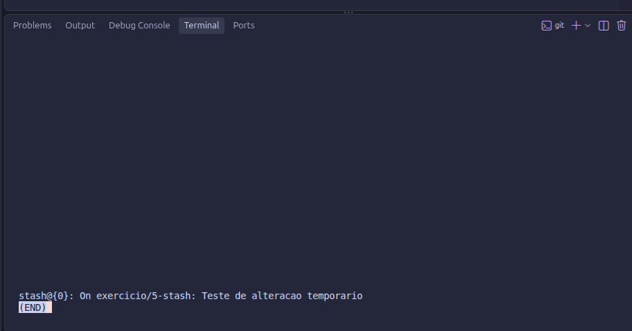
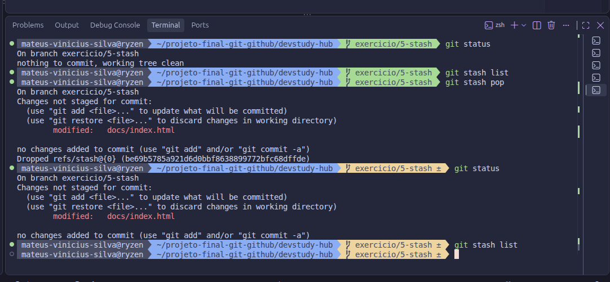
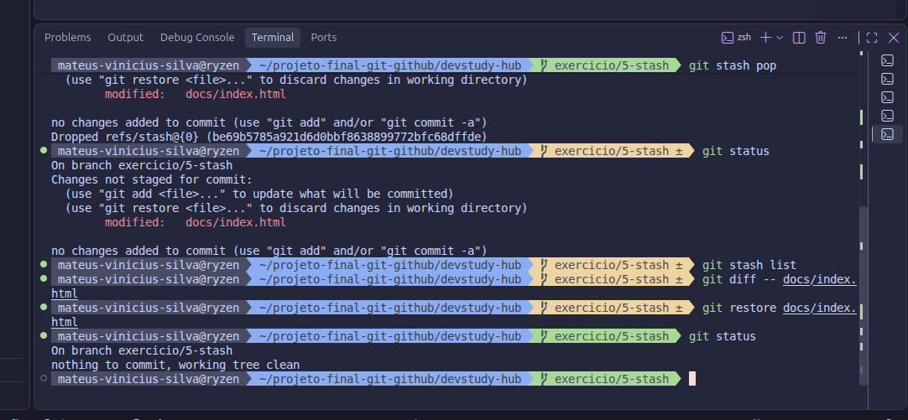
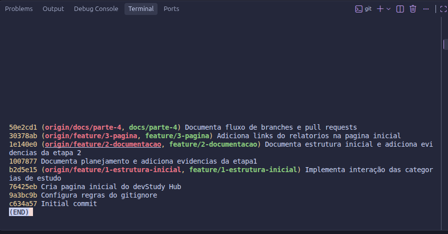
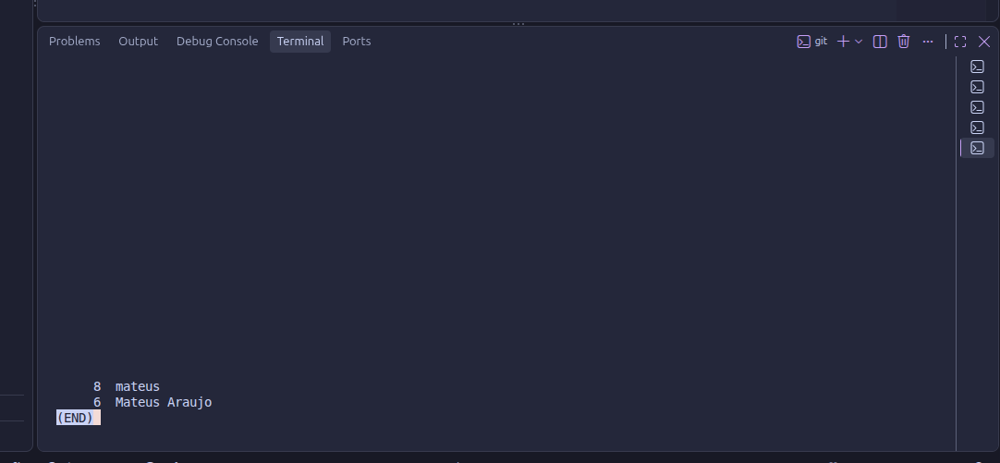
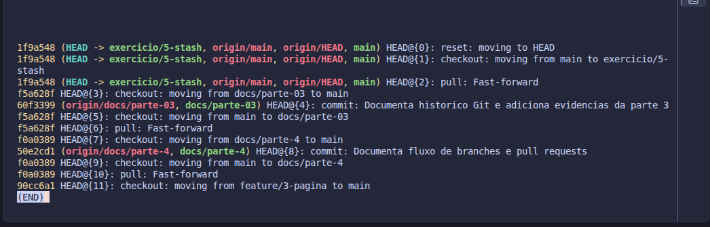

# Parte 5 — Stash e investigação

## 1. Objetivo

Praticar o armazenamento temporário de alterações não finalizadas utilizando `git stash` e investigar o histórico do DevStudy Hub com os comandos `git diff`, `git log`, `git shortlog` e `git reflog`.

O exercício foi realizado na branch `exercicio/5-stash`, criada a partir da `main`, sem alterar diretamente o conteúdo da branch principal.

## 2. Procedimentos realizados

### 2.1. Criar e analisar uma alteração temporária

Adicionamos um comentário de teste ao arquivo já rastreado `docs/index.html`, sem criar commit:

```bash
echo '<!-- Alteração temporária para testar git stash -->' >> docs/index.html
git status -sb
git diff -- docs/index.html
```

O `git status` identificou o arquivo como modificado e o `git diff` mostrou a linha acrescentada com o símbolo `+`. Assim, foi possível verificar o conteúdo alterado antes de guardá-lo.



### 2.2. Guardar a alteração com stash

```bash
git stash push -m "Teste de alteracao temporaria"
git status -sb
git stash list
```

O `git stash push` armazenou temporariamente a alteração sem gerar um commit de desenvolvimento. O diretório de trabalho ficou limpo e a entrada `stash@{0}` apareceu na lista de stashes.



### 2.3. Recuperar e descartar a alteração de teste

```bash
git stash pop
git status -sb
git stash list
```

O `git stash pop` recuperou a alteração no arquivo `docs/index.html` e, como a aplicação foi bem-sucedida, removeu a entrada correspondente da lista de stashes.



Após confirmar que havia apenas a alteração de teste, utilizamos:

```bash
git diff -- docs/index.html
git restore docs/index.html
git status -sb
```

O `git restore` descartou a modificação temporária e o `git status` confirmou o diretório de trabalho limpo. Esse comando só é apropriado quando as alterações descartadas não precisam ser preservadas.



## 3. Investigação do histórico Git

### 3.1. `git log`

Utilizamos `git log --oneline --no-merges` para consultar o histórico de forma resumida e identificar os commits de conteúdo, sem exibir os commits de merge.

Foi importante utilizar o comando `git log` para visualizar e analisar cada um dos commits realizados durante o desenvolvimento do DevStudy Hub, acompanhando a linha do tempo das alterações no repositório.



### 3.2. `git shortlog`

```bash
git shortlog -s -n HEAD
```

O `git shortlog` agrupa e contabiliza os commits por nome de autor. Na captura, aparecem `mateus` com oito commits e `Mateus Araujo` com seis. Esses são **nomes registrados nos commits**, e não comprovação de duas pessoas diferentes: podem representar configurações de autoria distintas do mesmo colaborador.



### 3.3. `git reflog`

```bash
git reflog -n 12
```

O `git reflog` apresentou movimentações locais de `HEAD`, incluindo trocas de branch, atualizações por `pull` e commits. Ele é útil quando uma referência muda e precisamos localizar um estado anterior, por exemplo após um `git reset`. A presença de uma referência no reflog pode ajudar a localizar o identificador de um commit que deixou de aparecer no `git log` da branch atual.



## 4. Resultado

Concluímos a simulação de uma alteração não finalizada, armazenando-a com `git stash`, recuperando-a com `git stash pop` e restaurando o arquivo original com `git restore`.

Também registramos como cada comando ajudou na investigação:

| Comando | O que permitiu investigar |
|---|---|
| `git diff` | O conteúdo exato de uma alteração ainda não registrada em commit |
| `git log` | O histórico e a sequência dos commits |
| `git shortlog` | A contagem de commits agrupada por autor |
| `git reflog` | Os movimentos locais das referências Git, úteis para localizar estados anteriores |

**Resultado final da prática:** branch `exercicio/5-stash` com diretório de trabalho limpo, sem precisar registrar a alteração temporária em um commit.

## 5. Evidências e cuidados

As sete capturas desta parte estão disponíveis em [`evidencias/05-stash-investigacao/`](../../evidencias/05-stash-investigacao/). Antes de publicar em um repositório público, revise eventuais dados pessoais exibidos nas capturas.

**Referência:** [Issue #266 — Parte 5: Stash e investigação](https://github.com/tech-devops-ltda/DevOps/issues/266).
